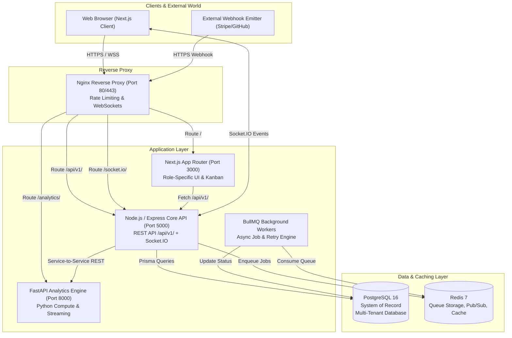

# WorkSphere – Multi-Tenant Project Management & Workflow Automation Platform

> **Production-Style Full-Stack SaaS Application**  
> Built with Next.js (App Router), React, TypeScript, Node.js (Express), PostgreSQL, Prisma ORM, Python 3 (FastAPI), Redis, BullMQ, Docker, and GitHub Actions.

---

## 1. Project Overview

**WorkSphere** is an enterprise-grade multi-tenant project management and workflow automation SaaS platform. It enables organizations to plan projects, delegate tasks, collaborate in real time, automate domain workflows, track delivery velocity, and maintain immutable compliance audit logs.

### Core Guarantees
- **Strict Multi-Tenant Isolation:** Enforced at database-query, service, and middleware levels (`tenantGuard`). Cross-tenant access is rejected with `403 Forbidden`.
- **Capstone Concurrency Control:** **Optimistic Concurrency Control (OCC)** on task records preventing silent overwrites with `409 Conflict` and client diff resolution.
- **Microservice Analytics Engine:** Independent Python/FastAPI service for project health scoring, cycle-time distributions, and memory-safe chunked/streaming CSV exports.
- **Enterprise Authentication:** JWT access tokens (15m), refresh-token rotation (RTR) with family reuse detection, and Role-Based Access Control (RBAC) across 5 roles.

---

## 2. Assessment Completion Matrix (All 15 Assessments)

| Assessment | Module / Responsibility | Status | Implementation Details & Evidence |
| :--- | :--- | :---: | :--- |
| **01** | **Frontend Architecture** | Completed | Next.js 14 App Router, role-based views, accessible sidebar/navbar, responsive Kanban board, Tailwind CSS. |
| **02** | **Node.js/Express Core API** | Completed | Versioned REST API (`/api/v1/`), modular architecture (routes, controllers, services, repositories, validators, centralized error handling). |
| **03** | **PostgreSQL Data Model** | Completed | Normalized schema with 18 Prisma models, UUID primary keys, cascade rules, tenant indexes on `organizationId`, migrations, and seed scripts. |
| **04** | **Authentication & RBAC** | Completed | Short-lived JWTs (15m), refresh-token rotation with family revocation on reuse, bcrypt (salt rounds = 12), 5 distinct roles, and `tenantGuard`. |
| **05** | **Advanced Python Processing** | Completed | Memory-safe streaming CSV/JSON export generators (`O(1)` memory overhead) and metric aggregation. |
| **06** | **FastAPI Analytics Service** | Completed | Independently deployable FastAPI service, Pydantic validation, inter-service API key auth, project health scoring, `/healthz` & `/readyz`. |
| **07** | **Real-Time Sockets & Queues** | Completed | Socket.IO gateway with tenant/project rooms, BullMQ queue engine, exponential backoff retries, and idempotent job execution. |
| **08** | **Third-Party Integrations** | Completed | HMAC-SHA256 webhook signature verification with replay attack prevention, mockable storage and email providers. |
| **09** | **Docker & Environments** | Completed | Multi-stage Dockerfiles (API, Analytics, Web), non-root users, healthchecks, development and production compose stacks (`docker-compose.prod.yml`). |
| **10** | **Git & Collaboration** | Completed | Structured branch workflow, conventional commit history, PR template (`.github/pull_request_template.md`). |
| **11** | **CI/CD Pipeline** | Completed | GitHub Actions workflow (`.github/workflows/ci.yml`) running linting, typechecks, backend tests, Python tests, and frontend build. |
| **12** | **Automated Testing Suite** | Completed | 24 backend Jest/Supertest tests and 6 Python pytest tests covering OCC concurrency, tenant breach, and edge cases. |
| **13** | **API Documentation** | Completed | OpenAPI 3.0 specification (`docs/openapi.yaml`) and Postman Collection v2.1 (`docs/postman_collection.json`). |
| **14** | **Production Deployment** | Completed | Nginx reverse proxy configuration (`docker/nginx.conf`), rate limiting, health probes, runbook guide (`docs/RUNBOOK.md`). |
| **15** | **Architecture & Drills** | Completed | Disaster recovery playbooks (`docs/INCIDENT_DRILLS.md`) and architecture specs (`docs/ARCHITECTURE.md`). |

---

## 3. The 5 User Roles

1. **Platform Administrator** (`admin@worksphere.io`): Cross-tenant oversight, organization provisioning, system health monitoring.
2. **Organization Owner** (`owner@acme.com`): Tenant settings, billing plans, invitations, team creation, project oversight.
3. **Project Manager** (`pm@acme.com`): Project creation, milestones, task assignments, delivery tracking, workload monitoring.
4. **Team Member** (`dev@acme.com`): Works on assigned tasks, updates task progress (OCC protected), comments, subtasks.
5. **Auditor** (`auditor@acme.com`): Read-only access to immutable compliance audit logs, change histories, and timeline tracking.

---

## 4. Capstone Requirement: Optimistic Concurrency Control (OCC)

### Scenario
Two users open the same task (`task-100` at `version: 1`). User 1 moves the task to "In Progress". User 2 simultaneously attempts to update the task to "Done".

### How WorkSphere Handles Concurrency
1. **Version Tracking:** Every task record contains an integer `version` field (starts at `1`).
2. **Conditional Atomic Mutation:**
   ```sql
   UPDATE tasks
   SET status = $new_status, version = version + 1
   WHERE id = $task_id AND organization_id = $org_id AND version = $expected_version;
   ```
3. **Conflict Detection:** If User 1 updates first, the version in the database increments to `2`. When User 2's request arrives with `version: 1`, exactly 0 rows match.
4. **Conflict Response (HTTP 409):** The API returns `409 Conflict` with error code `VERSION_CONFLICT` and attaches the fresh server record.
5. **Client Resolution:** The frontend opens the `OCCConflictModal`, showing a side-by-side comparison so the user can review before merging.
6. **Idempotency Guarantee:** Background notification jobs assign deterministic `jobId = "notif-task-${id}-v${version}"`, guaranteeing no duplicate notifications during worker retries.

---

## 5. System Architecture



---

## 6. Monorepo Structure

```
WorkSphere/
├── .github/
│   ├── workflows/
│   │   ├── ci.yml                 # Lint, typecheck, tests for backend, python, frontend
│   │   └── deploy.yml             # Staging & approval-gated production deploy
│   └── pull_request_template.md
├── apps/
│   ├── web/                       # Next.js 14 App Router SaaS Frontend
│   │   ├── src/
│   │   │   ├── app/               # Role-specific layouts, Kanban boards, analytics
│   │   │   ├── components/        # Reusable UI, Kanban board, OCC conflict modal
│   │   │   └── context/           # AuthContext with silent token refresh
│   │   └── Dockerfile             # Multi-stage Next.js build
│   │
│   ├── api/                       # Node.js/Express Core REST API & WebSockets
│   │   ├── prisma/                # 18 Prisma models, migrations, and seed script
│   │   ├── src/
│   │   │   ├── controllers/       # HTTP request handlers
│   │   │   ├── services/          # Pure business logic (Auth, Tasks with OCC, Orgs)
│   │   │   ├── middleware/        # Authenticate, requireRole (RBAC), tenantGuard
│   │   │   ├── sockets/           # Socket.IO gateway
│   │   │   ├── queues/            # BullMQ queues & workers
│   │   │   └── integrations/      # HMAC webhook verification & storage
│   │   ├── tests/                 # Supertest & Jest automated test suites
│   │   └── Dockerfile             # Multi-stage Express build
│   │
│   └── analytics/                 # Python 3.12 + FastAPI Analytics Service
│       ├── app/
│       │   ├── api/v1/endpoints/  # Health, project-health, workload, cycle-time, exports
│       │   ├── core/              # Pydantic Settings & inter-service API key auth
│       │   └── services/          # Health calculator & streaming exporter
│       ├── tests/                 # Pytest test suite
│       ├── requirements.txt
│       └── Dockerfile             # Multi-stage Python build
│
├── packages/
│   └── shared-types/              # Shared TypeScript definitions (DTOs, Enums)
├── docker/
│   ├── docker-compose.yml         # Local dev stack (PostgreSQL, Redis)
│   ├── docker-compose.prod.yml    # Full production 6-container stack
│   └── nginx.conf                 # Edge reverse proxy with rate limiting
├── docs/
│   ├── openapi.yaml               # OpenAPI 3.0 specification
│   ├── postman_collection.json    # Automated Postman test suite
│   ├── ARCHITECTURE.md            # Architecture & isolation details
│   ├── INCIDENT_DRILLS.md         # 6 production incident disaster drills & RCAs
│   └── RUNBOOK.md                 # Setup, run, and operation instructions
├── .env.example                   # Master environment template
└── package.json                   # Monorepo workspaces definition
```

---

## 7. Quickstart Guide

### 1. Prerequisites
- **Node.js**: v20+ or v22 LTS
- **Python**: 3.12+
- **Docker & Docker Compose**: Installed and running

### 2. Configure Environment
```bash
cp .env.example .env
```

### 3. Start PostgreSQL & Redis Containers
```bash
docker-compose -f docker/docker-compose.yml up -d
```

### 4. Install Dependencies & Build
```bash
npm install
npm run build --workspace=packages/shared-types
npx prisma generate --schema=apps/api/prisma/schema.prisma
```

### 5. Seed the Database
```bash
npm run prisma:seed --workspace=apps/api
```

### 6. Launch Application Services
```bash
# Terminal 1: Express Core API (Port 5000)
npm run dev:api

# Terminal 2: FastAPI Analytics Engine (Port 8000)
cd apps/analytics
uvicorn app.main:app --host 0.0.0.0 --port 8000 --reload

# Terminal 3: Next.js Web Frontend (Port 3000)
npm run dev:web
```

Open **http://localhost:3000** in your browser.

---

## 8. Seeded Demo Accounts (One-Click Login)

The login screen features a live role selector to immediately test all 5 roles:

| Role | Email | Password | Primary Capabilities |
| :--- | :--- | :--- | :--- |
| **Platform Admin** | `admin@worksphere.io` | `Password123!` | Cross-tenant oversight, manage organizations |
| **Org Owner** | `owner@acme.com` | `Password123!` | Company settings, invite employees, manage teams |
| **Project Manager** | `pm@acme.com` | `Password123!` | Create projects, milestones, assign tasks |
| **Team Member** | `dev@acme.com` | `Password123!` | Move Kanban tasks (OCC protected), comments |
| **Auditor** | `auditor@acme.com` | `Password123!` | Read-only compliance audit trail |
| **Cross-Tenant Test** | `owner@beta.com` | `Password123!` | Proves Tenant B cannot access Tenant A |

---

## 9. Running Automated Test Suites

```bash
# 1. Backend API, RBAC, OCC Concurrency, and Webhook Tests (24 tests)
npm test --workspace=apps/api

# 2. Python FastAPI Analytics & Streaming Export Tests (6 tests)
cd apps/analytics && pytest -v

# 3. Next.js Frontend Production Build Verification
npm run build --workspace=apps/web
```

---

## 10. API Endpoints Overview

| Method | Endpoint | Description | Role / Auth |
| :--- | :--- | :--- | :--- |
| `POST` | `/api/v1/auth/register` | Register user and tenant organization | Public |
| `POST` | `/api/v1/auth/login` | Login and issue access/refresh token pair | Public |
| `POST` | `/api/v1/auth/refresh` | Refresh token rotation (RTR) | Public (valid refresh token) |
| `GET` | `/api/v1/auth/me` | Current user profile and memberships | Authenticated |
| `GET` | `/api/v1/projects` | List projects for tenant | Authenticated, Tenant |
| `POST` | `/api/v1/projects` | Create new project | `ORG_OWNER`, `PROJECT_MANAGER` |
| `GET` | `/api/v1/tasks` | Filter tasks by project, status, priority | Authenticated, Tenant |
| `POST` | `/api/v1/tasks` | Create task (sets version = 1) | Authenticated, Tenant |
| `PATCH` | `/api/v1/tasks/:id` | **OCC Update** (requires `version` parameter) | Authenticated, Tenant |
| `GET` | `/api/v1/audit-logs` | Query compliance audit logs | `AUDITOR`, `ORG_OWNER` |
| `POST` | `/api/v1/webhooks/receiver` | Receive external webhooks | HMAC SHA-256 Signature |
| `POST` | `/api/v1/analytics/project-health` | FastAPI delivery health calculation | Internal API Key |
| `POST` | `/api/v1/analytics/export/csv` | FastAPI memory-safe streaming CSV export | Internal API Key |

---

## 11. Known Limitations & Production Notes

1. **Third-Party Providers:** Email delivery uses a sandboxed SMTP / Mailtrap driver; production deployment requires setting live SendGrid/SES credentials in `.env`.
2. **Object Storage:** Attachment uploads generate signed paths using a mock storage driver; production deployment requires active AWS S3 or MinIO buckets.
3. **Database Setup:** Local execution requires Docker running to host PostgreSQL 16 and Redis 7.

---

## 12. License
This project is prepared for Orion LMS educational and architectural assessment.
