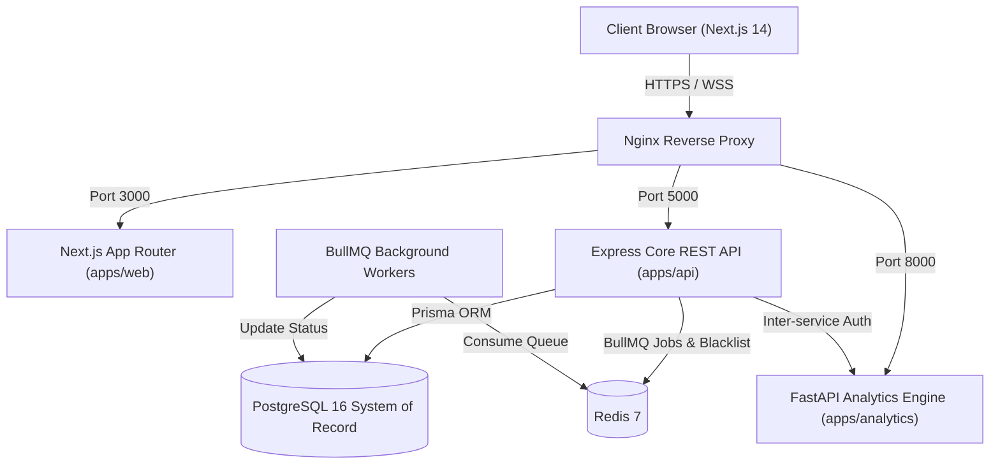

# WorkSphere System Architecture & Design Specification

## 1. System Overview

WorkSphere is a multi-tenant project management and workflow automation SaaS platform engineered with high data isolation, optimistic concurrency guarantees, and distributed background processing.



## 2. Multi-Tenant Data Isolation Strategy

WorkSphere employs **Logical Multi-Tenancy with Tenant ID Partitioning**:
1. All organization-owned tables (`projects`, `tasks`, `teams`, `comments`, `audit_logs`, `attachments`) contain an `organization_id` foreign key.
2. The `tenantGuard` Express middleware extracts `organizationId` from verified JWT claims or the `x-organization-id` header.
3. Cross-tenant access is rejected with `403 Forbidden` (`CROSS_TENANT_FORBIDDEN`) before queries touch the database.
4. Database queries strictly scope filters to `WHERE organization_id = $tenantId`.

## 3. Capstone Concurrency Control (OCC)

To prevent silent overwrites in collaborative Kanban boards, tasks implement **Optimistic Concurrency Control**:
- Each task record maintains an integer `version` (initialized to `1`).
- Mutation queries execute conditionally:
  ```sql
  UPDATE tasks 
  SET status = $new_status, version = version + 1 
  WHERE id = $id AND organization_id = $org_id AND version = $expected_version;
  ```
- If 0 rows match (due to a concurrent edit), the API throws `409 Conflict` (`VERSION_CONFLICT`) and returns the latest server snapshot.
- The UI presents a visual diff modal allowing the user to review before merging.

## 4. Service Boundaries & Data Ownership

| Service | Technology | Authoritative Responsibility | Data Ownership |
| :--- | :--- | :--- | :--- |
| **apps/web** | Next.js 14, React, Tailwind | User interface, Kanban boards, client state | Local session cache only |
| **apps/api** | Node.js, Express, Prisma | Business logic, authentication, RBAC, CRUD | PostgreSQL (System of Record) |
| **apps/analytics** | Python 3.12, FastAPI | Project health algorithms, cycle-time, exports | Ephemeral compute / Read-only metrics |
| **workers** | BullMQ, Node.js | Asynchronous notification delivery, emails | Redis queue state |
